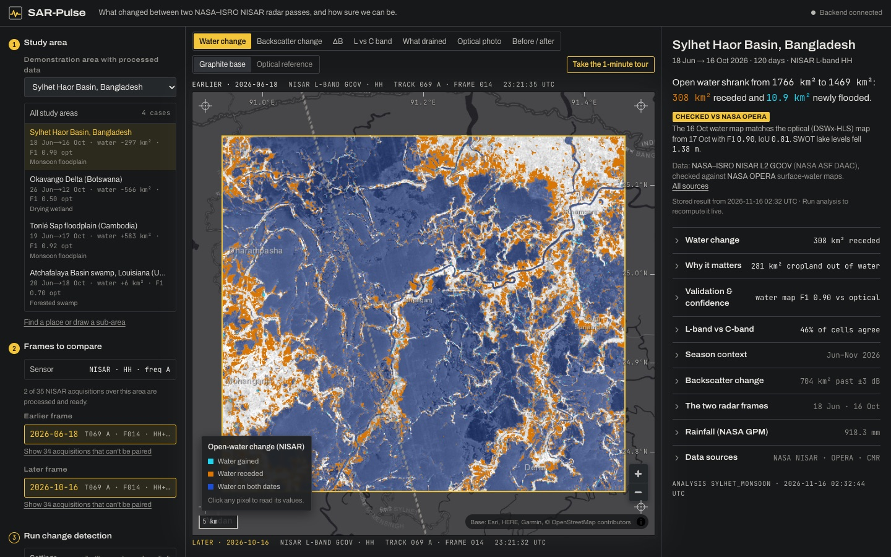
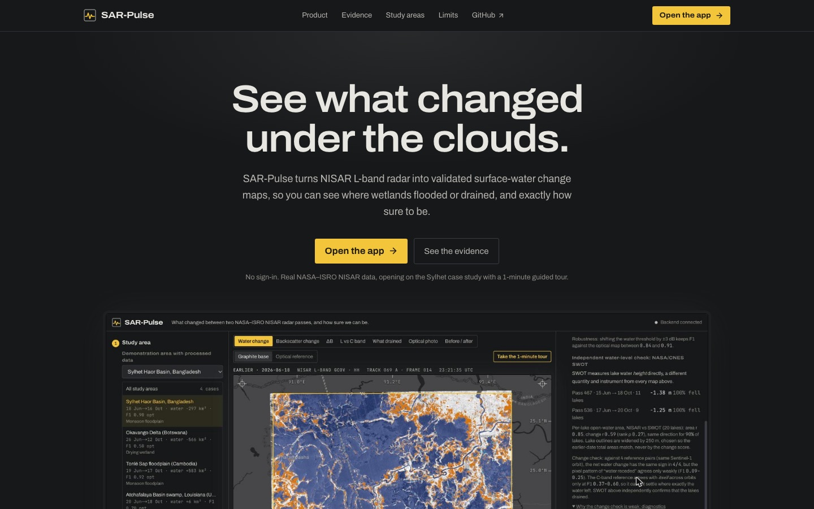

# SAR-Pulse

**What changed between two NASA–ISRO NISAR radar passes, and how sure can we be?**

SAR-Pulse turns real NISAR L-band radar observations into a validated surface-water change analysis:
- It maps open water on each date, with a threshold chosen automatically per image.
- It measures where water receded or appeared, and how backscatter changed.
- It scores those water maps against independent NASA OPERA surface-water products: radar (Sentinel-1) and cloud-free optical (Landsat/Sentinel-2).
- It compares NISAR's L-band change map with an independent C-band (Sentinel-1) change map, to show where the two wavelengths disagree and why.

> Every number in the app comes from processing real observations. Nothing is hard-coded or simulated.

**Case study:** monsoon drainage of the Sylhet haor wetlands, Bangladesh. NISAR track 69 ascending, frame 14, from **18 June to 16 October 2026** (120 days).

**Live app:** https://nasa-spaceapps-2026.vercel.app



<details>
<summary>Landing page</summary>



</details>

## NASA resources used

| NASA resource | Identifier | What SAR-Pulse uses it for | Status |
|---|---|---|---|
| **NISAR L2 GCOV**, Geocoded Polarimetric Covariance (V1). NASA–ISRO mission, distributed by NASA's ASF DAAC | Provisional [`C2854338529-ASF`](https://cmr.earthdata.nasa.gov/search/concepts/C2854338529-ASF.html) (Jun–Oct frames) and validated [`C3622241360-ASF`](https://cmr.earthdata.nasa.gov/search/concepts/C3622241360-ASF.html) (late Oct–Nov) | **Primary data.** All radar frames, change maps, statistics and potential-inundation flags are computed from these L-band observations | ✅ Used |
| **NASA Common Metadata Repository (CMR)** | [cmr.earthdata.nasa.gov/search](https://cmr.earthdata.nasa.gov/search/) | Finds NISAR acquisitions over the study area: dates, track, frame, polarizations, footprints, download and QA links | ✅ Used |
| **NASA Earthdata Login** | [urs.earthdata.nasa.gov](https://urs.earthdata.nasa.gov/) | Authenticates the NISAR downloads | ✅ Used |
| **OPERA DSWx-S1** surface water from Sentinel-1 (NASA JPL OPERA, NASA PO.DAAC) | `OPERA_L3_DSWX-S1_V1`, `C2949811996-POCLOUD` | **Independent validation**: radar-based water maps one day after each NISAR pass | ✅ Used |
| **OPERA DSWx-HLS** surface water from Landsat/Sentinel-2 (NASA JPL OPERA, NASA PO.DAAC) | `OPERA_L3_DSWX-HLS_V1`, `C2617126679-POCLOUD` | **Independent validation**: cloud-free optical water maps | ✅ Used |
| **OPERA RTC-S1** Sentinel-1 backscatter (NASA JPL OPERA, NASA ASF DAAC) | `OPERA_L2_RTC-S1_V1`, `C2777436413-ASF` | **C-band comparison**: an independent change map from a shorter wavelength | ✅ Used |
| **SWOT LakeSP Prior, Version D** (NASA/CNES SWOT, NASA PO.DAAC) | `SWOT_L2_HR_LakeSP_prior_D`, `C3233942291-POCLOUD` | **Independent water-level evidence**: lake water-surface height and area, measured directly | ✅ Used |
| **HLS** surface reflectance (HLSL30/HLSS30 v2.0; NASA LP DAAC) | `C2021957657-LPCLOUD`, `C2021957295-LPCLOUD` | True-colour images of clear days (15 Sep, 4 Oct, 17 Oct) for the map's "Optical photo" view | ✅ Used |
| **SMAP** L3 Enhanced soil moisture (NASA NSIDC DAAC) | `SPL3SMP_E`, `C2938664763-NSIDC_CPRD` | Context for false positives: soil drying lowers land backscatter | ✅ Used |
| **ASF Global 30 m HAND** (Alaska Satellite Facility) | `s3://glo-30-hand/v1/2021` | Terrain check: the basin lies a median 0.2 m above drainage | ✅ Used |
| **ICESat-2 ATL13** inland water height (NASA NSIDC DAAC) | `C3565574351-NSIDC_CPRD` | Checked as a second altimeter; only 2 in-basin passes on different tracks, so no before/after possible | ⛔ Checked, not usable |
| **GPM IMERG Late daily V07**. NASA GPM mission, distributed by NASA GES DISC | `GPM_3IMERGDL`, CMR collection `C2723754859-GES_DISC`, [doi:10.5067/GPM/IMERGDL/DAY/07](https://doi.org/10.5067/GPM/IMERGDL/DAY/07) | Rainfall around the acquisition dates (environmental context) | ✅ Used (season series via NASA Earthdata cloud OPeNDAP) |

The case study uses these two NISAR granules (provisional collection `C2854338529-ASF`, product version 1.0.11), from NASA's ASF DAAC:
- `NISAR_L2_PR_GCOV_023_069_A_014_4005_DHDH_A_20260618T232135_20260618T232210_P05023_N_F_J_001` (18 Jun 2026)
- `NISAR_L2_PR_GCOV_033_069_A_014_4005_DHDH_A_20261016T232132_20261016T232206_P05023_N_F_J_001` (16 Oct 2026)

The app also includes stored results for 16 Oct → 9 Nov and 28 Oct → 9 Nov. The 9 Nov and 28 Oct granules come from the validated collection, product version 1.0.20.

The same list is served live at `GET /api/sources` and shown in the app under **Data sources**. Non-NASA resources (JRC Global Surface Water, ESA WorldCover, Esri basemaps) and the unused RCM are listed there and in [docs/data_sources.md](docs/data_sources.md).

## Quick start

Prerequisites: [uv](https://docs.astral.sh/uv/), Node ≥ 20, and a NASA Earthdata account.

```bash
# 1. Backend environment (Python 3.11; rasterio wheels bundle GDAL)
uv venv --python 3.11 .venv
uv pip install --python .venv -r requirements-dev.txt

# 2. Credentials: create a token at https://urs.earthdata.nasa.gov → Generate Token
cp .env.example .env        # then set EARTHDATA_TOKEN=...  (username/password not needed)
#    Optional, for GPM rainfall: in your Earthdata profile → Applications → Authorized Apps,
#    approve "NASA GESDISC DATA ARCHIVE".

#    For the OPERA C-band data, also approve ASF's app (the download error links to it), and
#    accept the PO.DAAC terms if prompted.
# 3. Process the real NISAR frames. Only the study-area window is read from each ~7 GB HDF5 file over HTTPS
#    (h5py + Earthdata-authenticated range requests, ~5 frames in parallel); --download fetches full files instead.
.venv/bin/python scripts/fetch_demo.py --area sylhet_haor --max-granules 20   # re-running skips processed frames
# 4. Fetch the independent references on the same grid
.venv/bin/python scripts/fetch_reference.py   # NASA OPERA water maps, Sentinel-1 C-band, land cover (~450 MB)
.venv/bin/python scripts/opera_timeline.py    # season-long OPERA water fraction for the season chart
.venv/bin/python scripts/fetch_swot.py        # NASA/CNES SWOT lake heights/areas (~650 MB of continent-wide files)
.venv/bin/python scripts/fetch_rainfall.py    # NASA GPM IMERG daily rainfall via cloud OPeNDAP
.venv/bin/python scripts/fetch_soil_moisture.py  # NASA SMAP soil moisture via cloud OPeNDAP
.venv/bin/python scripts/fetch_context.py     # ASF HAND, WorldPop 2025, NASA HLS true colour
.venv/bin/python scripts/nisar_season.py      # NISAR water fraction + validation for every processed frame

# 5. Run (the Next.js dev server forwards /api/* to uvicorn on :8000)
.venv/bin/uvicorn backend.api.main:app --port 8000      # API + docs at :8000/docs
cd frontend && npm install && npm run dev                # landing at http://localhost:3000, tool at /explore
```

`scripts/fetch_demo.py --catalog-only` lists the real acquisitions from NASA CMR without downloading anything.

**Any other study area, one command.** `scripts/run_area.py --area <id>` (areas in `scripts/demo_areas.json`) runs every
step above for that area, chooses the featured pair as the season span (earliest and latest NISAR dates that both have an
independent optical reference; chosen from dates and reference availability only, never from agreement scores), and
stores the analysis as `<id>_featured`. `scripts/validation_diagnostics.py --analysis <id>` writes the diagnostics.

## Reproducing the analysis
1. Open http://localhost:3000 for the landing page, or go straight to the tool at http://localhost:3000/explore (add `?area=okavango`, `tonle_sap` or `atchafalaya` to open another study area). The featured pair, 18 Jun → 16 Oct, is preselected, and its stored result opens.
2. Press **Take the 1-minute tour**. It steps through the problem, the data, the discovery, the validation and the wavelength comparison, switching the map view as it goes.
3. Explore on your own using the map views: **Water change**, **Backscatter change**, **ΔB**, **L vs C band** and **Before / after**. Click any pixel to read its values.
4. Press **Run analysis** to recompute live. It takes about 15–20 s, and progress is shown.

The same analysis can be run headless:
```bash
.venv/bin/python -c "from backend.processing.pipeline import run_analysis; import json; \
r = run_analysis('sylhet_haor', '<earlier granule id>', '<later granule id>'); print(json.dumps(r['validation']['accuracy'], indent=1))"
```

## Deploying to Vercel

`vercel.json` deploys two services as one Vercel project:

| Service | Root | Framework | Public path |
|---|---|---|---|
| `api` | `.` | FastAPI (`backend.api.main:app`) | `/api/*` |
| `web` | `frontend/` | Next.js | everything else |

The browser calls the API on the same origin (`/api/...`), so the services need no bindings.

Data ships **inside the deployment**, because `data/` is not in git and the Hobby plan's Blob limits were exceeded
(the Blob store was deactivated). Git deployments are disabled in `vercel.json`; deploy from a machine that has the data:

```bash
.venv/bin/python scripts/upload_to_blob.py --stage data_bundle   # copies the ~950 MB the app needs into data_bundle/
npx vercel deploy --prod                                           # uploads code + data_bundle
```

On Vercel the API detects `data_bundle/` and reads it read-only (`SARPULSE_STORAGE=blob` is ignored when a bundle is present).
Blob mode still works for a store within its plan limits: remove `data_bundle/`, set `SARPULSE_STORAGE=blob`, and run
`scripts/upload_to_blob.py` with `BLOB_READ_WRITE_TOKEN` set.

On Vercel:
- **Runtime behaviour:** analyses run inside the request (about 20 s; the function limit is 300 s) and write to `/tmp`. With bundled data, a new live analysis is visible only on the instance that computed it; the stored analyses are always available.
- **Local testing:** `vercel dev` runs both services together.
- **Rainfall:** GPM precipitation also needs `EARTHDATA_TOKEN` set as a project environment variable.

## Tests
```bash
.venv/bin/python -m pytest backend/tests     # 41 tests
```
- **36 tests on synthetic rasters** (unit and API tests; synthetic data is never shown in the app).
- **5 tests on real NISAR results** (`backend/tests/test_real_data.py`): they recompute the headline areas from the stored
  Sylhet rasters and check version/track compatibility, the land-cover table's counts and intervals, and that single-date
  water-map scores are kept separate from change scores. They are skipped when `data/` is absent.

## Repository
```
backend/   ingestion, preprocessing, processing, comparison, environmental_context, validation, api, tests
frontend/  Next.js + MapLibre (app/, maps/, components/, dashboard/, services/)
scripts/   fetch_demo.py, demo_areas.json
docs/      architecture, methodology, data_sources, validation, limitations
data/      raw/ processed/ reference/   (git-ignored; created by the scripts)
```

## Status against the acceptance checklist
| Item | Status |
|---|---|
| Starts locally with documented instructions | ✅ |
| Frontend ↔ backend communication | ✅ Same-origin `/api`, deployed on Vercel |
| Real NISAR observations loaded and inspected | ✅ 7 GCOV frames over Sylhet (plus every frame of three further study areas), with HDF5 metadata recorded |
| Compatible metadata enforced | ✅ Same track, direction, polarization and product. A product-version difference is flagged as a warning |
| Real change-detection result | ✅ Backscatter change plus open-water change |
| Georeferenced display | ✅ UTM 46N COGs → XYZ tiles |
| Statistics from valid pixels | ✅ |
| Independent validation | ✅ Pixel-wise against NASA OPERA DSWx-HLS (optical) and DSWx-S1 (radar): precision, recall, F1, IoU, κ, plus a threshold-sensitivity sweep |
| Multi-wavelength comparison | ✅ NISAR L-band vs Sentinel-1 C-band (NASA OPERA RTC-S1). RCM itself could not be obtained |
| Dates and sensor metadata inspectable | ✅ |
| Clear errors for missing or incompatible data | ✅ |
| Assumptions and limitations documented | ✅ `docs/` |
| No simulated results presented as real | ✅ Synthetic data appears only in tests |
| GPM precipitation | ✅ Daily basin-mean series, Jun–Nov 2026 |
| Water-level evidence | ✅ NASA/CNES SWOT lake heights and areas, per lake |
| Calibration check | ✅ Invariant-target ΔB reported with every analysis |

## Findings: Sylhet haor wetlands, 18 June → 16 October 2026

**Question.** How much of the Sylhet haor wetlands drained between monsoon high water and the post-monsoon season? How well does NISAR L-band map that water compared with independent NASA OPERA maps? And where does L-band see change that C-band does not?

**1. The wetlands drained.**
- NISAR maps open water across **1766 km²** of the 2237 km² basin on 18 June (79%). By 16 October that is **1469 km²** (66%).
- **308 km²** receded, and only 11 km² newly flooded.
- The thresholds were chosen automatically for each image (Otsu, -12.24 and -12.02 dB). Both histograms were clearly bimodal (separability η 0.801 and 0.794).

**2. The water maps agree with an independent optical sensor.**
- Against the cloud-free NASA OPERA DSWx-HLS map (Landsat-9, 17 Oct, one day later), the 16 October NISAR water map scores **F1 0.90, IoU 0.81, κ 0.74** (precision 0.83, recall 0.97).
- Shifting the threshold by ±3 dB keeps F1 between 0.84 and 0.91, so the agreement does not depend on one lucky threshold.
- A second optical check, 28 Oct NISAR against Sentinel-2B on 27 Oct, gives F1 0.85.

**3. Against C-band radar, NISAR finds much more water.**
- Recall against OPERA DSWx-S1 is ≥ 0.99, but precision is only 0.58–0.59: NISAR marks as water many pixels that the C-band map calls land.
- On the same pixels on 17 Oct, NISAR maps 68% as open water, C-band 40%, and optical 56%. Optical is closer to L-band, but NISAR also over-calls water relative to optical (precision 0.83).
- The C-band reference is itself uneven: on near-same days it finds 15–47 percentage points less water than optical, and in June its four orbits, within a week, map 687–1,356 km² of water (see [validation diagnostics](docs/validation.md#diagnostics-final-round-what-the-weak-change-score-means)).

**4. The two wavelengths disagree where there is water.**
- Comparing NISAR's change map with an independent Sentinel-1 C-band change map (OPERA RTC-S1, orbit 41, 2026-06-19 → 2026-10-12) on 100 m cells, the bands agree on **46%** of cells.
- **Herbaceous wetland (66,628 cells): agreement 32.5% (95% interval 27–38%, κ 0.05, near chance)**, with C-band alone reporting change on 62.1% of cells. This holds across cell sizes (100/200 m), aggregation rules and ΔB thresholds of 2–4 dB (31–34% agreement, C-only 55–64%). Permanent water is similar (31.5%, C-only 56.6%).
- Tree cover agrees on 90.8% of cells, but **88.9 points of that are both bands seeing no change** (κ 0.27); it ranges 75–99% with the aggregation rule, so it is not a robust headline.
- **Across sites**, the most consistent difference is on permanent open water: C-band alone reports change on 57% (Sylhet), 58% (Tonlé Sap) and 25% (Atchafalaya) of cells, L-band alone on ≤ 7%. In vegetated wetland the bands also disagree, but the direction depends on the site: C-band-only change dominates in Sylhet (62%), **L-band**-only change in the drying Okavango (63%, mostly brightening), and in Tonlé Sap's large flood both bands see the same darkening (96% agreement). So there is no single "C-band misses it" mechanism; the bands respond to different things in vegetated water.
- This is consistent with known physics: C-band (5.6 cm) is more sensitive than L-band (24 cm) to wind ripples and emergent vegetation. The bands also differ in polarization (HH vs VV), geometry and dates (≤ 4 days), so it is a plausible explanation, not a proven one.

**5. An independent instrument confirms the drainage.** NASA/CNES SWOT measures lake water *height* directly.
- Paired lake by lake between the SWOT passes closest to the NISAR dates, **every lake it observed fell**: median **-1.38 m** across 11 lakes (pass 467, 2026-06-15 → 2026-10-18) and **-1.25 m** across 9 lakes (pass 536). SWOT's measurement uncertainty is 3–5 cm.
- Per-lake open-water area agrees between NISAR and SWOT at r = 0.848 (20 lakes). Per-lake area *change* agrees at r = 0.59 (rank ρ 0.266, so a few large lakes drive r), with the same direction for 90% of lakes.
- Lake outlines are widened by 250 m, chosen by matching earlier-date total area, never by the change score.

**6. Rainfall explains the timing.** NASA GPM IMERG basin-mean rainfall was 364 mm in June, 303 mm in July and 308 mm in August, then fell to 141 mm in September and 24 mm in October. The monsoon switched off before the drainage. This is coincidence in time, not proof of cause.

**7. The two frames are radiometrically consistent.** Buildings and trees that stayed land changed by a median of 0.00 dB between the passes, so the change is not a calibration artefact. The same check flags the mixed-version pair (16 Oct → 9 Nov, product versions 1.0.11 / 1.0.20) at -0.72 dB, beyond the 0.5 dB tolerance, and the app warns about it.

**8. NISAR tracks the whole season, and optical agrees at every clear date.** Seven NISAR passes (18 Jun to 9 Nov) show open water falling steadily from 79% to 63% of the basin. Every pass with a clear optical map nearby agrees closely:
- 2026-09-10: F1 **0.93** vs optical (2026-09-15, ±5 d)
- 2026-09-22: F1 **0.95** vs optical (2026-09-27, ±5 d)
- 2026-10-04: F1 **0.98** vs optical (2026-10-04, ±0 d)
- 2026-10-16: F1 **0.90** vs optical (2026-10-17, ±1 d)
- 2026-10-28: F1 **0.85** vs optical (2026-10-27, ±1 d)

**9. Optical before/after confirms which neighbourhoods drained.** For 10 Sep → 16 Oct, both ends have clear optical maps (15 Sep, 17 Oct).
- NISAR's "water receded" map agrees with optical on the direction of change in **93% of 500 m cells** that changed (r = 0.353).
- At pixel level it agrees only modestly: F1 0.30, direction 54% at 100 m. NISAR finds the right areas, but exact edges differ.

**10. Why it matters.** Between 18 June and 16 October:
- **281 km² of cropland** (ESA WorldCover 2021) came out of the water (268–294 km² for water thresholds ±1 dB; total receded 289–327 km²). Haor farmers prepare boro rice seedbeds as water recedes in November–December, so the map ("What drained" view) shows where planting can start.
- About **1.26 million people** live in the basin (WorldPop 2025). Nearly all live within 1 km of land that drained (87% within 200 m), so proximity does not single out an affected group; it is context, not a measure of harm.
- Roughly **2.1 km³** of water left the basin. This is an order of magnitude: mean water area × SWOT level drop.
- NASA SMAP monthly-mean soil moisture fell from 0.45 (June) to 0.23 m³/m³ (October), which is why some land backscatter also changed.

## More study areas (same pipeline, no per-area tuning)

Each was processed with `scripts/run_area.py`; the pair is the season span with optical references at both ends.
Figures are from the stored `<area>_featured` analyses (`GET /api/summary`).

| Area | Ecosystem | NISAR track | Pair | Open water | Optical F1 (per date) | Calibration | Notes |
|---|---|---|---|---|---|---|---|
| Sylhet haor, Bangladesh | Monsoon floodplain | 069 A | 18 Jun → 16 Oct | 1,766 → 1,469 km² | 0.85–0.98 (5 dates) | 0.00 dB | Main case study |
| Tonlé Sap, Cambodia | Flood-pulse lake | 083 A | 19 Jun → 17 Oct | 1,046 → 1,629 km² | 0.63 (Jun), 0.92 (Oct) | −0.63 dB ⚠ | Flooding; L/C agree in wetland (96%, κ 0.45). Calibration offset exceeds tolerance and is flagged |
| Okavango delta, Botswana | Drying seasonal swamp | 172 A | 26 Jun → 12 Oct | 644 → 78 km² | 0.50 (Jun), 0.19 (Oct) | −0.12 dB | **Weak case.** Fixed −18 dB fallback (histogram not bimodal); against optical open + partial water F1 0.68 in June. NISAR maps about twice the optical open water; likely causes (not verified) are radar-dark dry sand and shallow vegetated water that optical scores as partial |
| Atchafalaya, Louisiana (USA) | Forested river swamp | 084 D | 20 Jun → 18 Oct | 192 → 199 km² | 0.55 (Jun), 0.70 (Oct) | −0.46 dB | Little open-water change; flooding under the canopy is not open water and is not measured. No population layer (national file 1.5 GB) |

Configured in `scripts/demo_areas.json` but not processed for lack of time: Majuli (Assam), Indus (Sindh), Mamirauá (Amazon).

**What this does not show.**
- **No ground truth.** The references are other satellite products, not field observations, and they disagree with each other.
- **Pixel-exact edges are not confirmed.** Neighbourhood-level change agrees with optical (point 9), but at 20 m pixels the "water receded" map agrees only modestly with optical (F1 ≈ 0.30) and weakly with the C-band reference (F1 0.09–0.25, a reference that agrees with *itself* across orbits only at F1 0.37–0.60). June is too cloudy for an optical pair.
- **Possibly missed water.** Flooded vegetation under a canopy can look bright to L-band, and is not counted as open water.
- **No depth.** Nothing here measures water depth.

See [docs/methodology.md](docs/methodology.md), [docs/validation.md](docs/validation.md), [docs/limitations.md](docs/limitations.md) and the 2-minute [demo script](docs/demo_script.md).
